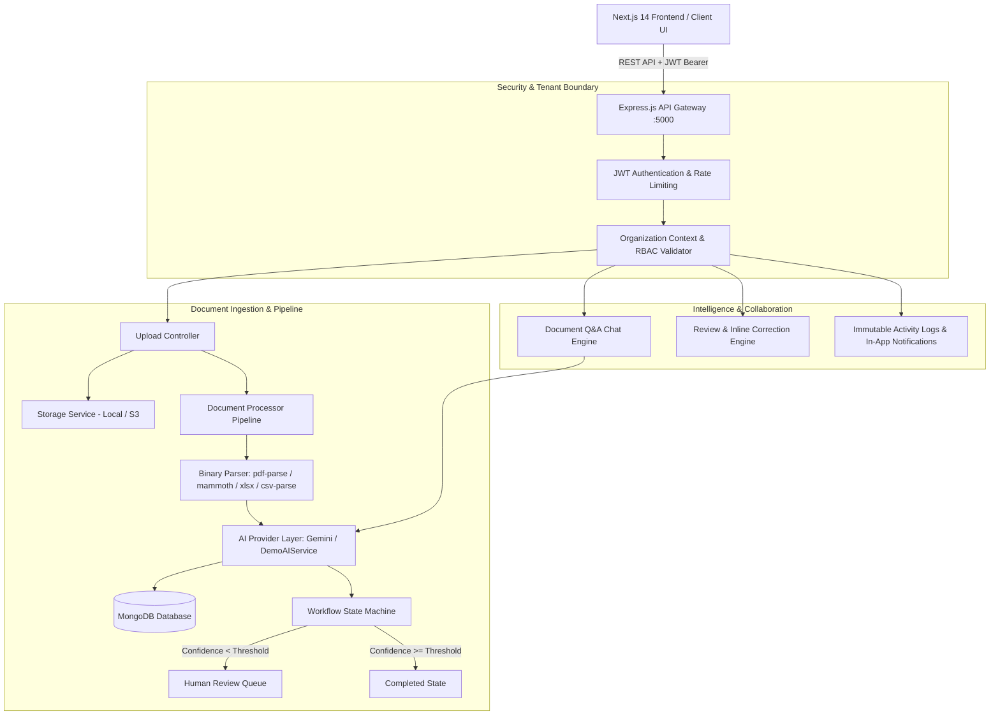

# 📄 DocIntel AI — Document Intelligence & Autonomous Workflow Platform

[](https://nextjs.org/)
[](https://react.dev/)
[](https://www.typescriptlang.org/)
[](https://nodejs.org/)
[](https://expressjs.com/)
[](https://www.mongodb.com/)
[](https://tailwindcss.com/)
[](https://opensource.org/licenses/MIT)

> A production-grade, full-stack enterprise platform for ingesting unstructured documents across 6+ file formats, extracting structured business entities, orchestrating multi-tier human review approvals, executing grounded AI Q&A with source citations, and searching content via high-performance database indexing.

---

## 🌟 Executive Summary & Highlights

DocIntel AI is built to demonstrate genuine end-to-end full-stack engineering. **Every single button, upload handler, database query, status transition, and AI feature is completely operational.**

- **Real Document Ingestion**: Ingests **PDF**, **DOCX**, **XLSX**, **CSV**, **TXT**, and image formats with file-type whitelisting, 25MB limits, and SHA-256 deduplication.
- **AI Extraction Pipeline**: Automatically parses binary streams, recognizes 12+ structured entities (invoices, currencies, organizations, dates, persons, line items), and scores extraction confidence.
- **Transparent AI Provider Abstraction**: Supports Google Gemini models (`gemini-1.5-flash`) via official SDK and includes a deterministic regex & heuristic fallback engine (`DemoAIService`) that clearly marks outputs as `[Demo Analysis]` when external API keys are omitted.
- **Workflow State Machine**: Evaluates extracted data against confidence thresholds and routes documents through `Uploaded` &rarr; `Processing` &rarr; `Completed` or `Review Required`.
- **Human-in-the-Loop Review Queue**: Dedicated split-screen review dashboard where authorized users can inspect raw document text, edit entity values inline, reject, or approve with audit comments.
- **AI Chat with Document Grounding**: Multi-turn Q&A engine that retrieves source paragraphs and outputs cited text snippets alongside confidence metrics.
- **Global Multi-Field Search**: Real-time regex and text queries across titles, raw text, entity keys, values, and summaries with highlighted match snippets.
- **Enterprise Multi-Tenancy & RBAC**: Organization-isolated databases with 4-tier Role-Based Access Control (`Owner`, `Admin`, `Reviewer`, `Member`).
- **Complete Audit Trail & Notifications**: Tracks immutable activity logs and emits in-app notifications for pipeline milestones.

---

## 📐 Architecture & Pipeline



---

## 🛠 Tech Stack

| Layer | Technology | Description |
|---|---|---|
| **Frontend Framework** | Next.js 14 (App Router) | Server-side rendering, React 18, streaming, client layouts |
| **Styling & Design** | Tailwind CSS + Lucide Icons | Enterprise dark/light design system, glassmorphism, micro-animations |
| **Backend Runtime** | Node.js (v20+) + Express.js | Scalable REST API with modular controllers and middleware |
| **Programming Language**| TypeScript 5.8 | End-to-end type safety between database schemas, APIs, and client |
| **Database & ODM** | MongoDB + Mongoose 8.12 | Schemas with compound indexes, text indexes, and relations |
| **File Parsing** | `pdf-parse`, `mammoth`, `xlsx`, `csv-parse` | In-memory binary parsing for PDFs, Word, Excel, and CSVs |
| **AI Intelligence** | Google Gemini (`@google/genai`) + Demo Engine | Hybrid extraction, summarization, and citation Q&A |
| **Authentication** | JWT + `bcryptjs` | Multi-tenant organization memberships and password hashing |
| **File Storage** | Pluggable Storage Abstraction | Local disk storage with pluggable AWS S3 driver interface |

---

## 📂 Repository Structure

```
AI-Document-Intelligence-Workflow-Platform/
├── package.json                   # Root package script runner (dev, build, seed, typecheck)
├── .env.example                   # Environment configuration blueprint
├── .gitignore                     # Git exclusion rules
├── README.md                      # Comprehensive developer documentation
│
├── client/                        # Next.js 14 Frontend Application
│   ├── next.config.js             # Next.js rewrites to backend API (:5000)
│   ├── tailwind.config.js         # Theme tokens, dark mode, colors, typography
│   ├── tsconfig.json              # Strict TypeScript frontend configuration
│   └── src/
│       ├── app/
│       │   ├── page.tsx           # Enterprise SaaS Landing Page
│       │   ├── layout.tsx         # Global Root Layout (Theme, Auth, Toast providers)
│       │   ├── globals.css        # Global CSS, Tailwind base & utility classes
│       │   ├── (auth)/            # Auth routes: /login, /register, /forgot-password, /reset-password
│       │   └── (dashboard)/       # Protected SaaS routes
│       │       ├── layout.tsx     # Dashboard Shell with Sidebar, Header & Org Switcher
│       │       ├── dashboard/     # Metrics, upload trends, quick actions, activity feed
│       │       ├── documents/     # Document grid/list, filters, folder navigation, tags
│       │       │   └── [id]/      # Split-view Document Inspector, Q&A chat, field editor
│       │       ├── review/        # Human review queue, low-confidence triage, decisions
│       │       ├── workflows/     # Workflow definitions, step transitions, trigger rules
│       │       ├── search/        # Global search with regex, facets, and highlight snippets
│       │       ├── analytics/     # Analytics charts, type distribution, approval rates
│       │       ├── team/          # Organization member invitations and role management
│       │       ├── settings/      # Org quotas, AI provider settings, preferences
│       │       └── notifications/ # In-app notification center with read/unread tracking
│       ├── components/            # Reusable UI components (Sidebar, Header, OrgSwitcher, FileUploader)
│       ├── context/               # AuthContext, ThemeContext, ToastContext
│       ├── lib/                   # REST API client (api.ts) and formatters (utils.ts)
│       └── types/                 # Frontend TypeScript interfaces
│
└── server/                        # Express.js REST API Backend
    ├── tsconfig.json              # Server TypeScript configuration (builds to dist/)
    ├── uploads/                   # Physical file storage directory
    └── src/
        ├── server.ts              # Express initialization, middleware stack, graceful shutdown
        ├── config/                # Environment variables, database connection, options
        ├── models/                # 13 Mongoose models with compound indexes
        │   ├── User.ts            # User accounts, hashed passwords, preferences
        │   ├── Organization.ts    # Tenant accounts, storage limits, custom settings
        │   ├── Membership.ts      # Multi-tenant user roles (owner, admin, reviewer, member)
        │   ├── Document.ts        # Document metadata, status, text index, confidence
        │   ├── ExtractedData.ts   # Extracted fields, entities, review corrections
        │   ├── Workflow.ts        # Workflow state machine definitions & step thresholds
        │   ├── WorkflowExecution.ts# Workflow run history, transitions, and step logs
        │   ├── Review.ts          # Human reviews, approval notes, and decisions
        │   ├── Comment.ts         # Document comments and discussion threads
        │   ├── Folder.ts          # Hierarchical folder organization
        │   ├── Tag.ts             # Custom metadata tags
        │   ├── Notification.ts    # Real-time event notifications
        │   └── ActivityLog.ts     # Immutable audit trails
        ├── controllers/           # Business logic controllers
        ├── middleware/            # Auth, Organization, Role guard, Multer file upload
        ├── routes/                # Express router declarations
        ├── services/
        │   ├── storage/           # Local file storage and S3 interface abstraction
        │   ├── parser/            # Multi-format binary text extractor (PDF, DOCX, XLSX, CSV, TXT)
        │   ├── ai/                # AI abstraction (GeminiAIService, DemoAIService, Factory)
        │   ├── workflowEngine.ts  # Workflow state transitions and auto-approval logic
        │   ├── documentProcessor.ts# Ingestion pipeline orchestrator
        │   ├── notificationService.ts # Event notification dispatcher
        │   └── activityLogger.ts  # Audit log recorder
        └── seeds/
            └── seed.ts            # Realistic seed script with demo users, documents & workflows
```

---

## 🔑 Demo Accounts & Pre-Seeded Data

The seed script (`npm run seed`) populates realistic enterprise datasets, including financial invoices, master services agreements, financial spreadsheets, vendor disbursements, and employment contracts.

All pre-seeded demo accounts share the password: **`Password123!`**

| Email Address | Full Name | Primary Role | Organization |
|---|---|---|---|
| `admin@docintel.io` | Alexandra Vance | **Owner / Admin** | Acme Financial Global & Apex Legal |
| `reviewer@docintel.io` | Marcus Chen | **Reviewer** | Acme Financial Global |
| `member@docintel.io` | Sarah Jenkins | **Member** | Acme Financial Global |
| `auditor@docintel.io` | David Kalu | **Reviewer** | Acme Financial Global |

> **Tip:** You can use the **1-Click Quick Demo Switcher** directly on the `/login` page to sign in as any of these roles without typing!

---

## 🚀 Quick Start & Installation

### Prerequisites

- **Node.js**: v18.0.0 or higher (v20+ recommended)
- **npm**: v9.0.0 or higher
- **MongoDB**: Local MongoDB instance running on `mongodb://127.0.0.1:27017` or MongoDB Atlas URI

### 1. Clone & Install Dependencies

```bash
# Clone the repository
git clone https://github.com/hitankoliya9051/AI-Document-Intelligence-Workflow-Platform.git
cd AI-Document-Intelligence-Workflow-Platform

# Install root, backend, and frontend dependencies
npm install
npm --prefix server install
npm --prefix client install
```

### 2. Configure Environment Variables

Create `.env` in the root workspace or copy from `.env.example`:

```bash
cp .env.example .env
```

**Contents of `.env`**:
```env
# Backend API Port & Node Environment
PORT=5000
NODE_ENV=development

# MongoDB Connection String
MONGODB_URI=mongodb://127.0.0.1:27017/docintel_platform

# JWT Authentication Secrets
JWT_SECRET=super_secret_docintel_production_jwt_key_2026_change_in_production
JWT_EXPIRES_IN=7d
BCRYPT_SALT_ROUNDS=10

# AI Provider Selection: 'demo' | 'gemini'
AI_PROVIDER=demo
# GEMINI_API_KEY=your_gemini_api_key_here
GEMINI_MODEL=gemini-1.5-flash

# File Storage Configuration: 'local' | 's3'
STORAGE_PROVIDER=local
STORAGE_LOCAL_DIR=./uploads

# Client URL (for CORS)
CLIENT_URL=http://localhost:3000
```

### 3. Seed Database with Realistic Documents

Run the database seed script to populate organizations, users, physical sample documents, workflows, and audit logs:

```bash
npm run seed
```

### 4. Run Development Servers

Start both the Express backend and Next.js frontend concurrently with a single command:

```bash
npm run dev
```

- **Frontend Application**: [http://localhost:3000](http://localhost:3000)
- **Backend API Server**: [http://localhost:5000/api](http://localhost:5000/api)
- **API Health Check**: [http://localhost:5000/api/health](http://localhost:5000/api/health)

---

## 🧪 Comprehensive API Documentation

All routes require `Authorization: Bearer <JWT>` and optionally `x-organization-id: <orgId>` (defaults to user's active organization).

### Authentication (`/api/auth`)
| Method | Endpoint | Description |
|---|---|---|
| `POST` | `/api/auth/register` | Register new user and initial organization |
| `POST` | `/api/auth/login` | Authenticate with email/password, returns JWT & user profile |
| `GET` | `/api/auth/me` | Fetch active session, user data, and available organizations |
| `POST` | `/api/auth/switch-org` | Switch active organization context |
| `POST` | `/api/auth/forgot-password`| Generate password reset token |
| `POST` | `/api/auth/reset-password` | Reset password using verified token |
| `POST` | `/api/auth/logout` | Terminate session and record audit log |

### Document Management (`/api/documents`)
| Method | Endpoint | Description |
|---|---|---|
| `POST` | `/api/documents/upload` | Upload document file via multipart/form-data |
| `GET` | `/api/documents` | List documents with pagination, filters, status, folders & tags |
| `GET` | `/api/documents/:id` | Retrieve full document details, extracted text, and fields |
| `GET` | `/api/documents/:id/download` | Download original binary file |
| `GET` | `/api/documents/:id/preview` | Preview document inline |
| `PATCH`| `/api/documents/:id` | Update metadata (title, description, folder, tags) |
| `POST` | `/api/documents/:id/archive` | Move document to archive |
| `POST` | `/api/documents/:id/restore` | Restore document from archive |
| `DELETE`| `/api/documents/:id` | Permanently delete document (Owner/Admin only) |
| `POST` | `/api/documents/:id/process` | Re-trigger parsing and AI extraction pipeline |
| `POST` | `/api/documents/:id/chat` | Multi-turn Q&A chat over document content with citations |

### Extraction & Reviews (`/api/extractions` & `/api/reviews`)
| Method | Endpoint | Description |
|---|---|---|
| `GET` | `/api/extractions/:documentId` | Get structured fields and entity dictionary |
| `PATCH`| `/api/extractions/:documentId` | Submit human corrections to extracted fields |
| `GET` | `/api/reviews/queue` | Fetch documents waiting in the Human Review Queue |
| `POST` | `/api/reviews/:documentId` | Submit review decision (`approve`, `reject`, `request_changes`) |

### Workflows & Search (`/api/workflows` & `/api/search`)
| Method | Endpoint | Description |
|---|---|---|
| `GET` | `/api/workflows` | List workflows in the active organization |
| `POST` | `/api/workflows` | Create a new multi-step document workflow |
| `GET` | `/api/search` | Global search across documents, extracted fields, and tags |

### Analytics & Collaboration
| Method | Endpoint | Description |
|---|---|---|
| `GET` | `/api/analytics` | Overview metrics, document type breakdown, and volume trends |
| `GET` | `/api/notifications` | List user in-app notifications |
| `PATCH`| `/api/notifications/:id/read` | Mark notification as read |
| `GET` | `/api/activities` | Immutable audit trail of all platform events |
| `GET` | `/api/comments/:documentId` | Fetch document discussion thread |
| `POST` | `/api/comments/:documentId` | Post a comment or feedback note |

---

## 🛡 Security & Enterprise Compliance

1. **Strict Tenant Isolation**: All queries enforce `{ organizationId: req.organizationId }`. Cross-tenant data leakage is prevented at the database driver level.
2. **Role-Based Access Control (RBAC)**:
   - **`owner`**: Full organization control, billing, member management, and deletions.
   - **`admin`**: Workspace configuration, user invites, workflow authoring, review overrides.
   - **`reviewer`**: Access to the Review Queue, inline entity correction, approval/rejection decisions.
   - **`member`**: Document upload, inspection, AI chat, folder creation, and commenting.
3. **Password Security**: Passwords hashed with `bcryptjs` using adaptive salt rounds.
4. **Input Sanitization**: Request bodies validated strictly against Zod schemas.
5. **Secure File Streaming**: Validates MIME types, checks magic headers, enforces 25MB limits, and isolates file paths.

---

## ⚙️ Testing & Verification

Run the full verification suite across both backend and frontend:

```bash
# Typecheck both TypeScript projects
npm run typecheck

# Verify Next.js production build
npm --prefix client run build

# Verify Express backend production build
npm --prefix server run build
```

---

## 📦 Production Deployment

### Building for Production

```bash
# Build backend to dist/ and frontend to .next/
npm run build
```

### Running in Production

```bash
npm run start
```

Or run via PM2 / Docker:
- **Server**: `node server/dist/server.js` (behind Nginx reverse proxy)
- **Client**: `next start client`

---

## 📄 License

This project is licensed under the MIT License — see the [LICENSE](LICENSE) file for details. Built for demonstration of enterprise-grade full-stack architecture.
